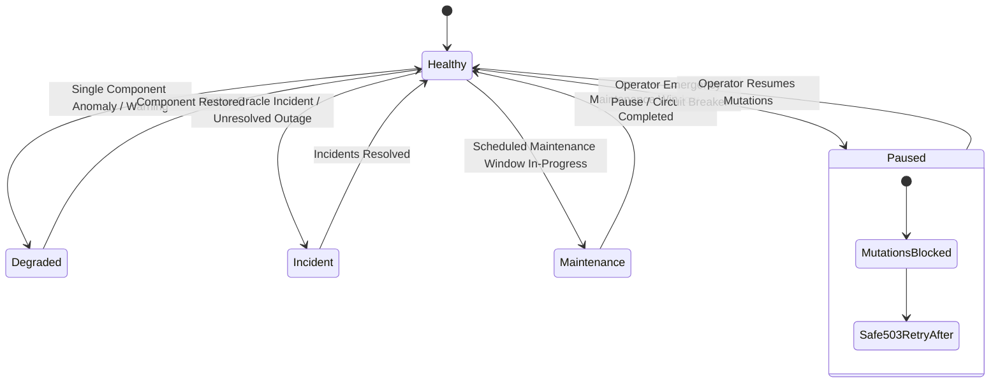

# Safe Public-Status Model for Degraded, Paused, or Maintenance States

Resolves **Issue #370**.

## 1. Overview and Architecture

The Verdant Bond Protocol status system exposes unauthenticated status feeds for investor dashboards, institutional partner monitoring, and external status pages (e.g. status.verdantbond.org) while providing operator controls to pause or degrade specific protocol operations during anomalies or scheduled migrations.

The status model (`api/src/status/status-safeguards.ts`, `api/src/status/status.service.ts`) satisfies three core architectural guarantees:
1. **Public vs. Operator Boundary Protection**: Zero internal secrets, Stellar private keys, database connection URIs, internal IP subnets, or stack traces can leak into public status feeds.
2. **Explicit State Hierarchy**: Deterministic progression across `healthy`, `degraded`, `paused`, `incident`, and `maintenance`.
3. **Mutation Safeguard Enforcement**: When the protocol or a specific component is paused or in maintenance, all state mutations (bond issuance, secondary trades, coupon claims, KYC updates) are blocked across API, UI, and background workers with HTTP 503 + `Retry-After: 60`.



---

## 2. Status State Hierarchy

The overall status is derived deterministically from the component and incident states:

| Overall Status | Condition / Trigger | Public Behavior | State Mutation Policy |
|---|---|---|---|
| **`healthy`** | All components operational, no active incidents, no in-progress maintenance windows. | Green status indicator; normal operations. | **Allowed** |
| **`degraded`** | Non-critical component (e.g. cache, search index) offline, or non-critical latency warning. | Amber indicator; warning banner displayed. | **Allowed** (read fallback to primary store) |
| **`paused`** | Operator invoked `pauseProtocol` or critical component (`bond-issuance`, `dex-settlement`) paused. | Orange warning; "Protocol Operations Temporarily Paused". | **Blocked** (`assertMutationAllowed` throws `protocol_paused`) |
| **`incident`** | Active or unacknowledged Oracle coverage incident detected. | Red alert; incident timeline details displayed. | **Conditional** (oracle-dependent actions held) |
| **`maintenance`** | Maintenance window `status: in_progress`. | Blue banner; "Scheduled Maintenance in Progress". | **Blocked** (`protocol_maintenance`) |

---

## 3. Zero-Leak Secret Redaction Guarantees

Public feeds pass through `redactSecretsDeep()` before serialization. Any operator-supplied maintenance notices or error strings are scrubbed of:

| Sensitive Data Category | Regex Detection Pattern | Redaction Replacement |
|---|---|---|
| **Stellar Secret Seeds** | `/\bS[A-Z0-9]{55}\b/g` | `[REDACTED_STELLAR_SECRET]` |
| **Database Connection URIs** | `/(?:postgres\|postgresql\|mongodb\|redis):\/\/[^:\s]+:[^@\s]+@[^\s]+/gi` | `[REDACTED_DB_URI]` |
| **JWT & Bearer Tokens** | `/eyJ[A-Za-z0-9_-]+\.[A-Za-z0-9_-]+\.[A-Za-z0-9_-]+/g` | `[REDACTED_JWT]` |
| **IPv4 Internal Subnets** | `/\b(?:10\|127\|172\.(?:1[6-9]\|2[0-9]\|3[01])\|192\.168)\.\d{1,3}\.\d{1,3}(?::\d+)?\b/g` | `[REDACTED_IP]` |
| **Internal Stack/File Paths** | `/(?:[a-zA-Z]:\|\/)(?:[a-zA-Z0-9_.-]+[\\/])+[a-zA-Z0-9_.-]+\.[a-zA-Z0-9]{2,4}/g` | `[REDACTED_PATH]` |

---

## 4. Operational Mutation Safeguards

The `StatusService.assertMutationAllowed(componentName?: string)` method is integrated into controllers and background workers:

```typescript
// Controller Example
@Post('issue')
async issueBond(@Body() dto: IssueBondDto) {
  this.statusService.assertMutationAllowed('bond-issuance');
  return this.bondService.issue(dto);
}

// Background Worker Example
async processQueueBatch(jobs: Job[]) {
  if (!this.statusService.isMutationAllowed('coupon-distribution')) {
    this.logger.warn('Coupon distribution paused by operator; delaying batch execution.');
    return; // Leaves jobs in queue without failing or dropping
  }
  // Process batch normally
}
```

---

## 5. Operator Runbook

### Emergency Protocol Pause
When an external anomaly or exploit is detected:
```bash
# Pause all protocol mutations
curl -X POST https://api.verdantbond.org/status/pause \
  -H "Authorization: Bearer $ADMIN_JWT" \
  -H "Content-Type: application/json" \
  -d '{"reason": "Circuit breaker tripped due to anomalous oracle variance"}'
```
- Status immediately flips to `paused`.
- Public feed reflects `isMutationAllowed: false`.
- API returns `HTTP 503: Protocol state mutations are temporarily paused by operators.`

### Resuming Normal Operations
```bash
curl -X POST https://api.verdantbond.org/status/resume \
  -H "Authorization: Bearer $ADMIN_JWT"
```

### Pausing an Isolated Component
If only secondary trading needs maintenance without halting bond issuance or coupon distribution:
```bash
curl -X POST https://api.verdantbond.org/status/component/dex-settlement \
  -H "Authorization: Bearer $ADMIN_JWT" \
  -H "Content-Type: application/json" \
  -d '{"status": "paused", "notice": "Secondary market order book reconciliation in progress"}'
```

---

## 6. Compatibility Statement

- The public `StatusReport` schema maintains `schemaVersion: 1`.
- Existing unauthenticated consumers reading `overallStatus`, `components`, `incidents`, and `maintenanceWindows` continue to function without breaking schema changes.
- New fields (`isMutationAllowed`, `publicNotice`, component status `'paused'`) are additive.
