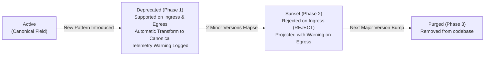

# Schema Evolution Guardrails for Stored Records and Public API Responses

Resolves **Issue #354**.

## 1. Overview and Rationale

The Verdant Bond Protocol evolves over time as new green bond covenants, carbon credit verification methodologies, and regulatory reporting standards emerge. Unconstrained schema changes can introduce:
1. **Database Schema Drift**: Inconsistent historical records that fail deserialization during audit replay.
2. **Public API Breakages**: Clients crashing due to unannounced field renames, removals, or unexpected data types.
3. **Payload Pollution**: Arbitrary undeclared fields injected into financial ledger states or public responses.

The `SchemaEvolutionGuardrails` (`api/src/common/versioning/schema-evolution-guardrails.ts`) enforces automated schema evolution rules across both **Ingress (Write Path / Storage)** and **Egress (Read Path / Public API)**.

---

## 2. Unknown Field Policies

Depending on the criticality and trust boundary of the subsystem, one of three deterministic policies is enforced:

| Policy | Behavior | Used By | Failure Code |
|---|---|---|---|
| **`REJECT`** | Rejects payload immediately with `SchemaEvolutionError`. Prevents parameter tampering or silent typos in critical parameters. | Financial state mutations, Cryptographic event ledger, Bond issuance | `unknown_field_rejected` (HTTP 400) |
| **`STRIP`** | Automatically removes undeclared fields from the payload and logs a quarantine audit event. Clean data is persisted. | Public API endpoints, Unauthenticated status feeds, Search queries | None (sanitized ingress) |
| **`PRESERVE_EXTENSION`** | Isolates undeclared fields into an explicit `extensions: Record<string, any>` bag without polluting core schema attributes. | Entity metadata, Green project impact reports, Auditor notes | None (isolated namespace) |

---

## 3. Deprecated Field Lifecycle

Fields follow a structured 3-phase deprecation lifecycle:



### Deprecation Specification Example
```typescript
{
  fieldName: 'projectId',
  deprecatedSinceVersion: '1.2.0',
  removedInVersion: '2.0.0',
  canonicalReplacement: 'projectRegistryId',
  fallbackTransform: (oldVal) => String(oldVal),
  sunsetNotice: 'Field "projectId" has been superseded by "projectRegistryId".',
}
```
- **Read Path**: If legacy client provides `projectId`, it is automatically converted to `projectRegistryId`.
- **Write Path**: Storage stores only `projectRegistryId`. Legacy `projectId` is deleted from stored record.
- **Client Egress**: Older clients requesting `X-API-Version: 1.0.0` receive projected responses containing `projectId` populated from `projectRegistryId`.

---

## 4. Bi-Directional Compatibility Pipeline

The protocol continuously tests backward and forward compatibility:
1. **Backward Compatibility**: New code (`V2.0.0`) must be able to ingest and deserialize legacy records (`V1.0.0`, `V1.1.0`, `V1.2.0`) without data loss or exceptions.
2. **Forward Compatibility**: When new records are returned to older clients, egress projection provides compatible fallbacks without throwing unexpected field errors.

---

## 5. Operational Failure Modes and Recovery Runbook

### Failure Mode 1: Ingress Unknown Field Rejection
- **Symptom:** Client receives `HTTP 400 Bad Request: Unknown field "xyz" rejected under strict schema guardrail for Bond.`
- **Diagnosis:** Upstream client submitted an unversioned parameter or a field scheduled for a future release.
- **Remediation:** Verify client version against `api/src/common/versioning/schema-versioning.ts`. If the field is an experimental metadata property, place it inside the `metadata` or `extensions` object.

### Failure Mode 2: Corrupted or Unmigrated Legacy Record
- **Symptom:** Storage read fails with `missing_required_field` on an unmigrated database record.
- **Remediation:**
  1. Inspect legacy record schema version:
     ```bash
     redis-cli GET "bond:101"
     ```
  2. Run the automated migration transform:
     ```bash
     npm run seed -- --migrate-bonds
     ```
  3. Validate schema compatibility:
     ```bash
     node --experimental-strip-types scripts/verify-schema-evolution.mjs
     ```

---

## 6. Compatibility Statement

- The schema evolution engine is completely backwards-compatible with existing V1.0.0, V1.1.0, and V1.2.0 bond records.
- Existing public REST endpoints continue serving canonical payloads without breaking changes.
