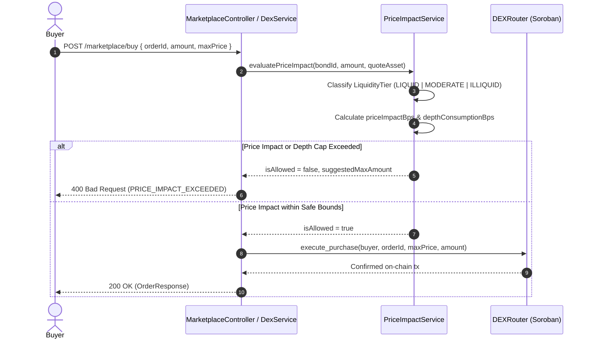

# Secondary-Market Price Impact Limits for Illiquid Tranches (#471)

## Overview & Background

Nature-based Solution (NbS) bonds listed on the Stellar secondary marketplace represent tokenized claims on diverse ecological projects (reforestation, blue carbon, mangrove restoration). Because discrete tranches possess distinct maturities, credit yields, and vintage profiles, secondary-market liquidity is often fragmented:
- **Liquid Tranches**: High transaction volume and deep order books (>= 25,000 units).
- **Moderate Tranches**: Active periodic liquidity (5,000 to 25,000 units).
- **Illiquid Tranches**: Thin order books (< 5,000 units total resting depth) where a taker purchasing a significant size can exhaust the book, induce extreme price slippage, or move the clearing price far above fair value.

Issue #471 introduces automated **liquidity tier classification**, **pre-trade price impact evaluation**, and **hard price-impact caps** to protect both market takers from predatory slippage and the tranche from book-clearing manipulation.

---

## 1. Liquidity Tier Classification

Tranches are classified dynamically based on available sell depth (`availableDepth`):

| Liquidity Tier | Depth Threshold (`availableDepth`) | Maximum Allowable Price Impact | Max Depth Consumption per Trade |
| :--- | :--- | :--- | :--- |
| **`LIQUID`** | `>= 25,000` tokens | **300 bps** (3.00%) | 100% |
| **`MODERATE`** | `5,000` to `24,999` tokens | **600 bps** (6.00%) | 100% |
| **`ILLIQUID`** | `< 5,000` tokens | **1,000 bps** (10.00%) | **5,000 bps** (50.00%) |

---

## 2. Mathematical Definition of Price Impact

For a purchase order of size $Q$ filled across $N$ sorted ask levels with quantities $q_i$ and prices $p_i$ ($\sum_{i=1}^N q_i = Q$):

1. **Total Execution Cost**:
   $$\text{TotalCost} = \sum_{i=1}^N q_i \times p_i$$

2. **Average Execution Price**:
   $$\bar{P}_{\text{exec}} = \frac{\text{TotalCost}}{Q}$$

3. **Ideal Cost** (evaluated against best ask $p_{\text{best}}$):
   $$\text{IdealCost} = Q \times p_{\text{best}}$$

4. **Price Impact (in basis points)**:
   $$\text{PriceImpact}_{\text{bps}} = \left( \frac{\text{TotalCost} - \text{IdealCost}}{\text{IdealCost}} \right) \times 10,000$$

5. **Depth Consumption (in basis points)**:
   $$\text{DepthConsumption}_{\text{bps}} = \left( \frac{Q}{\text{TotalAvailableDepth}} \right) \times 10,000$$

---

## 3. Enforcement Workflow & Failure Paths



---

## 4. API Endpoints

### 1. Pre-Trade Impact Evaluation
- **`GET /marketplace/prices/:bondId/impact`**
- **Query Params**: `amount` (positive integer string), `quoteAsset` (default `USDC`)
- **Response**:
  ```json
  {
    "bondId": 101,
    "requestedAmount": "2000",
    "quoteAsset": "USDC",
    "liquidityTier": "ILLIQUID",
    "availableDepth": "3000",
    "bestPrice": "100",
    "marginalPrice": "110",
    "averageExecutionPrice": "105",
    "totalCost": "210000",
    "priceImpactBps": 500,
    "maxAllowedImpactBps": 1000,
    "isAllowed": false,
    "depthConsumptionRatioBps": 6666,
    "maxDepthConsumptionBps": 5000,
    "reason": "Order consumes 66.7% of illiquid tranche depth, exceeding maximum allowable depth consumption of 50.0%",
    "suggestedMaxAmount": "1500"
  }
  ```

### 2. Tranche Configuration
- **`GET /marketplace/config/:bondId/impact-limits`**: Read current parameter set.
- **`PUT /marketplace/config/:bondId/impact-limits`**: Operator override for special bespoke issuances (requires `x-wallet-address` admin authorization).

---

## 5. Recovery, Retry, and Operational Edge Cases

1. **Retry with `suggestedMaxAmount`**:
   When an order is rejected with `PRICE_IMPACT_EXCEEDED`, the response payload includes a deterministic `suggestedMaxAmount`. Submitting a revised order matching or below this amount is guaranteed to satisfy the price-impact and depth-consumption caps.
2. **Order Book Depletion**:
   If asks are concurrently filled by another trader between quote preview and order execution, `DexService` re-fetches the live order from the ledger before calling `PriceImpactService`, preventing stale executions.
3. **Rollback & Invariants**:
   No on-chain state or escrow balance is modified if price impact validation fails; rejection happens off-chain before any Soroban contract invocation or nonce consumption.
